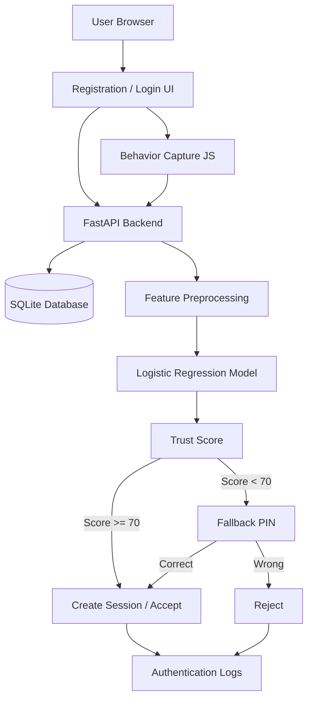

# System Architecture

## Modules
1. **Registration Module** — creates user and stores password/PIN hashes.
2. **Behavior Capture Module** — JavaScript collects timing and mouse features.
3. **Authentication Module** — checks password and calls the behavior model.
4. **ML Module** — trains Logistic Regression and returns probability as trust score.
5. **Fallback Module** — verifies PIN when behavioral anomaly is detected.
6. **Logging Module** — stores outcomes for demonstration and analysis.

## Data Flow
Browser → behavior features + credentials → backend → database/model → trust score → accept or PIN challenge → log result.
