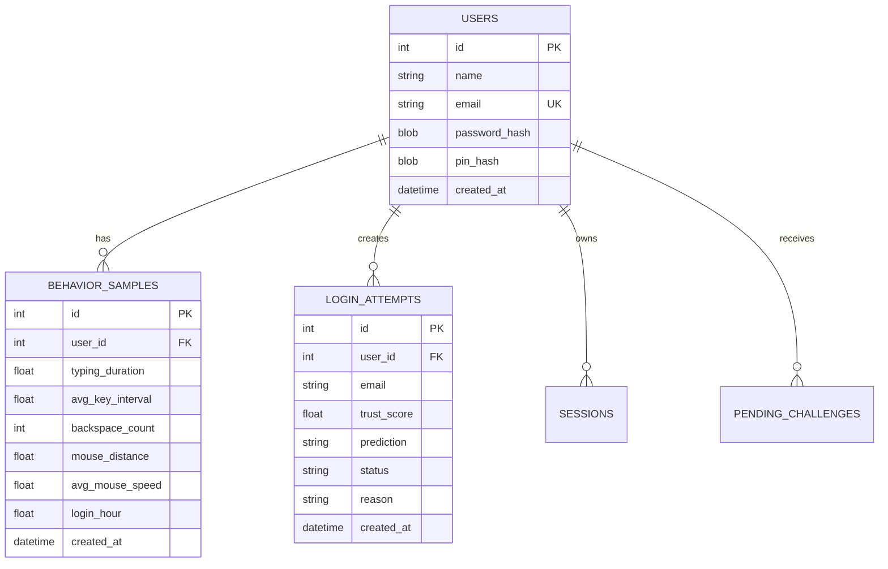

# Database Design

## ER overview

## Why these tables?
- `users`: identity and hashed secrets
- `behavior_samples`: baseline behavioral measurements used for ML training
- `login_attempts`: audit/anomaly history
- `sessions`: local authenticated sessions
- `pending_challenges`: temporary low-trust fallback PIN challenges
